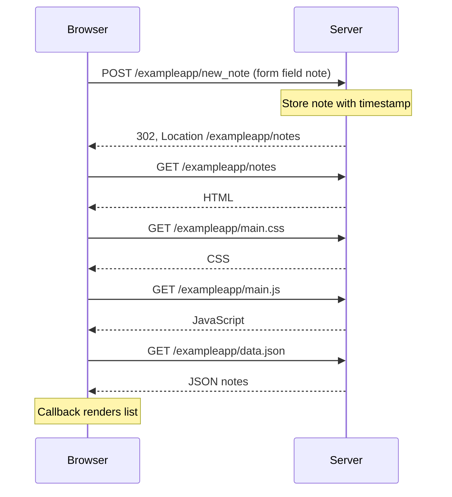

# 0.4 — Saving through the standard form

This starts when someone clicks Save on the open notes page. Each path belongs to `https://studies.cs.helsinki.fi`. The diagram assumes the browser cache is disabled. CSS and JavaScript downloads may overlap.

References: [Full Stack Open, Part 0](https://fullstackopen.com/en/part0/fundamentals_of_web_apps/), [example client](https://github.com/mluukkai/example_app/blob/master/public/spa.js), [example server](https://github.com/mluukkai/example_app/blob/master/index.js).
