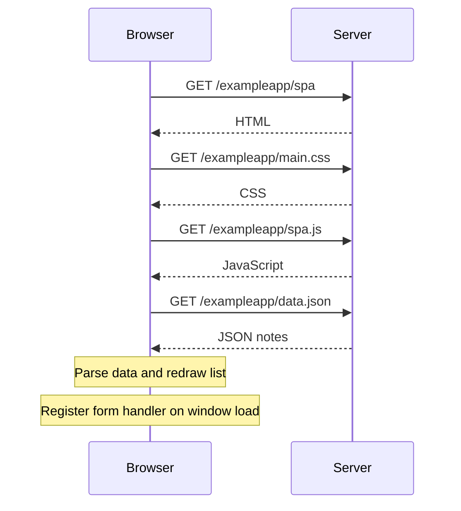

# 0.5 — Opening the single-page version

The data response and window load are separate events; their relative timing is not guaranteed.

References: [Full Stack Open, Part 0](https://fullstackopen.com/en/part0/fundamentals_of_web_apps/), [example client](https://github.com/mluukkai/example_app/blob/master/public/spa.js), [example server](https://github.com/mluukkai/example_app/blob/master/index.js).
